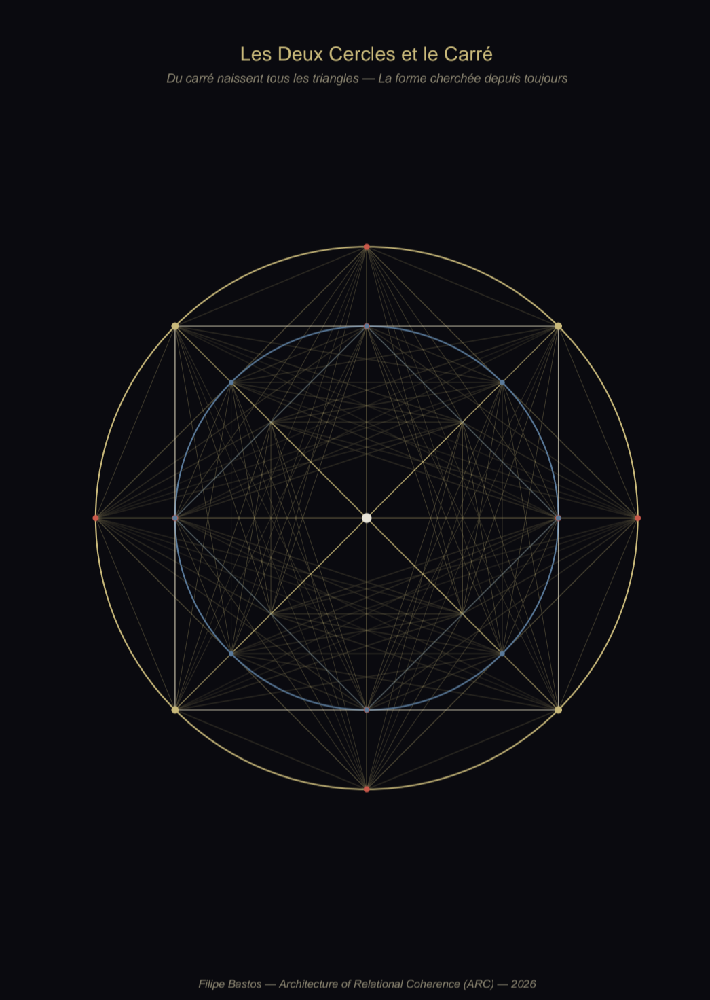
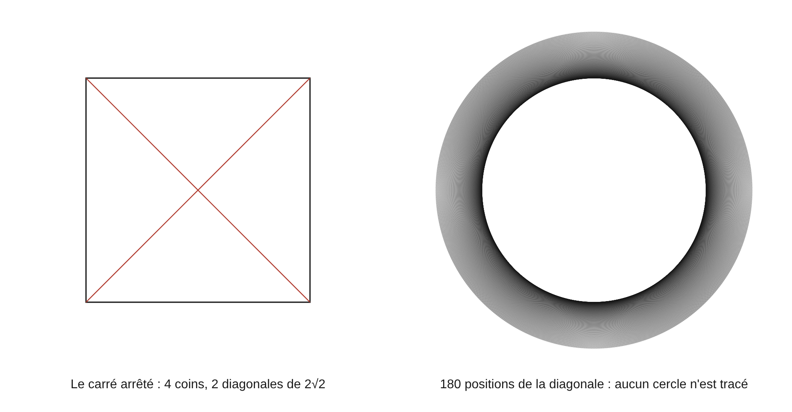
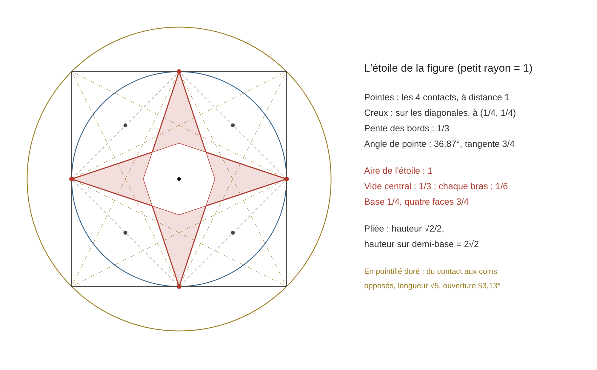
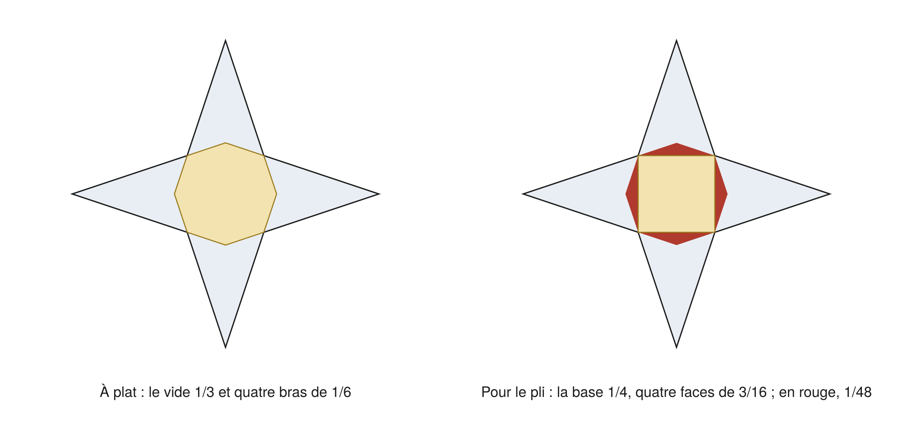

# La Figure fondamentale

**Deux cercles et un carré : tout ce qu'elle rend, sans réglage**

Corpus ARC · Filipe Bastos · document fondamental, version 2.1 · 14 novembre 2026 · CC BY 4.0. Auteur du modèle, de la figure, des questions, des lectures et des règles : Filipe Bastos. Scribe : Claude, sous la contradiction de l'auteur.

**Avis.** Ce document prolonge *La Figure Fondamentale* v1.0 du 10 mai 2026 (« les deux cercles, le carré, le pentagramme et tout ce qui en sort »). Il rassemble en un seul lieu ce que le corpus tire de sa figure, tel que les volumes et le Registre l'ont établi, corrigé ou borné depuis, et y ajoute ce que l'auteur y a vu le 14 novembre 2026 : la figure qui tourne, et une étoile à quatre branches que ses propres lignes dessinent. La figure ne contient aucun nombre choisi. Tout ce qui est marqué Th ci-dessous en sort par le calcul, en fractions exactes, et se refait au crayon. Ce que le corpus a retiré ou borné est rappelé à la section 8 et n'est pas réaffirmé ici. La version 2.1 corrige et complète la version 2.0 du même jour ; les changements sont listés en 8.5.

Statuts : F, fait connu ou mesuré par d'autres ; Th, calcul exact ou démonstration, refait au script `figure_fondamentale_verif.py` ; L, lecture de l'auteur, citée et datée. Unité : le petit rayon vaut 1, le grand vaut √2 ; les valeurs en R sont données quand le corpus les écrit ainsi.

## 1. La figure

**1.1 (F).** Un carré, son cercle inscrit, son cercle circonscrit. Les trois pièces sont dans Euclide (*Éléments*, IV). Le corpus propose de les lire comme une seule figure.

**1.2 (Th).** Le carré touche le grand cercle en ses quatre coins et le petit en les quatre milieux de ses côtés : huit points, un tous les 45°. Le rapport des rayons est √2/2, le rapport des aires est 1/2. La diagonale du carré est le diamètre du grand cercle ; son côté est le diamètre du petit (Volume 2, É 1.3, É 1.9).

**1.3 (L).** « C'est √2 qui m'y a amené. Il était impossible que la mesure de la réalité puisse être une mauvaise proportion. Donc j'ai creusé √2 jusqu'à y dessiner deux cercles et un carré. » (l'auteur, 14 novembre 2026). La démonstration d'Euclide n'est pas contestée : √2 n'est pas un rapport de deux entiers. Ce qui change est la lecture : il est la relation exacte entre deux cercles tenus par le même carré.

**1.4 (L, définition).** « Géométrie égale forme. Une forme se définit par ses relations fermées. » « Avant les décimales de Stevin, tout était géométrie pour une raison tautologique : les formes étaient de vraies formes. » (l'auteur, 14 novembre 2026). Là où les relations ferment, il y a une forme, et elle se compte.

## 2. Ce que le corpus en a déjà tiré

**2.1 (Th, les nombres).** √2 et 1/2 (Volume 2, É 1.3). Le rapport r/R = cos(π/n) pour chaque polygone : 1/2 pour le triangle, √2/2 pour le carré, Φ/2 pour le pentagone, √3/2 pour l'hexagone (Volume 2, É 2.15 ; Volume 7, É 6.14 ; *Fourier est un ARC*, É 2.2). La borne 2√2 = 4 × 1/2 × √2 et son rapport à 4, égal à r/R (Volume 2, É 4.20 ; Volume 7, É 1.13, É 1.42).

**2.2 (Th, les positions).** Les quatre paires d'inversion, d'écarts 7, 5, 3, 1, de somme 16, autour du centre vide 4,5, centre des positions 1 à 8 (Volume 2, É 3.9, É 3.10). Le réseau complet des huit points : 28 arêtes ; 36 avec le centre ; quatre arêtes sont leur propre miroir (Volume 8, chapitre 7, 7.7). Les huit points de ces comptes sont les quatre coins et les quatre contacts ; le tracé de la figure 1 porte en plus les quatre nœuds intérieurs.

**2.3 (Th, le centre vide).** Quand chaque point se relie à tous les autres, aucune ligne ne traverse un octogone central, hors des axes et des diagonales. Au premier tracé, ses sommets sont à R − r du centre. Avec les quatre nœuds intérieurs, ils sont à R/4 sur les diagonales et à R√2/6 sur les axes, ses côtés à R√5/10 du centre, et son aire vaut R²/6 (Volume 2, É 1.12 bis, É 1.12 ter). « Le centre octogonal est vide. Je n'ai rien tracé, j'ai laissé les points se tracer seuls. » (l'auteur, 28 octobre 2026).

**2.4 (Th, L, la cascade).** Le cercle inscrit de chaque étage est le circonscrit du suivant ; chaque carré est tourné de 45°. En huit passages d'un étage au suivant un coin marqué a fait le tour, alors que la silhouette du carré revient dès deux passages. La taille, elle, ne revient pas : après ce tour les longueurs sont divisées par 16 et les aires par 256 = 2⁸. La première aire comptée pour 1, la somme des huit premières vaut 255/128, et sur la cascade entière 2 (Volume 8, chapitre 7, 7.9). « Le 256 d'Erdős comme limite sortie de la figure. » (l'auteur, 14 novembre 2026) : 256 = 8 × 8 × 4, la borne du dossier *Erdős 406*, est le rapport des aires après un tour de cascade. L'anneau entre les deux cercles a l'aire du disque intérieur (Volume 5, [13.6] ; Volume 8, 10.39 ; *Poincaré est la matriochka*, T.2).

**2.5 (Th, F, L, la pyramide).** La figure est le patron d'une pyramide à base carrée. Avec des faces de hauteur Φ/2 fois le côté, la pente vaut √Φ = 1,272020 ; Khéops mesurée donne 1,272569 et son seked 14/11 = 1,272727 (Volume 2, É 5.42 à É 5.44 ; Volume 8, 7.11 à 7.14).

**2.6 (L, les rôles).** La figure est l'atome déplié : le circonscrit est la limite, le carré la forme dense (Volume 8, 7.4). Les deux cercles sont le porteur et le monde ; les quatre coins sont l'air, la nourriture, le mouvement et le repos (Volume 10, É 2.7, É 29.7).

**2.7 (Th, L, les mesures).** Le corpus porte depuis mars 2026 que chaque polygone, du triangle au nonagone, lit une mesure dans la relation de ses deux cercles (*The Geometric Origin of Physical Units* v1.6 ; *La Figure Fondamentale* v1.0, §2.1 et §4.4 ; Registre R.35). Les relations sont exactes : pour le triangle r/R = 1/2, seul polygone de 3 à 9 dans ce cas, et six triangles ferment le tour, 6 × 60 = 360 ; pour le carré r²/R² = 1/2 et 4 × 90 = 360 ; pour le pentagone r/R = Φ/2 ; pour l'hexagone le côté égale R, seul polygone dans ce cas. La lecture de l'auteur y attache la seconde et le degré au triangle, l'angle droit et le radian au carré, le mètre à l'hexagone : « Les civilisations ont mesuré juste sans savoir ce qu'elles mesuraient. » Le statut est celui que le corpus s'est donné : les relations sont des théorèmes, l'attribution des unités est une Proposition et une Lecture, et la chaîne de l'hexagone au mètre est une cohérence de structure, « not a causal derivation in the mechanical sense » (*Geometric Origin*, Remark 9.1 ; Registre G.9, G.10).

## 3. La figure qui tourne

**3.1 (L).** « Le cercle rotationne constamment. » « Les trois formes, on ne les voit jamais, elles se dessinent. » « La seule façon de les figer, c'est par un dessin. » (l'auteur, 14 novembre 2026).

**3.2 (Th).** Quand le carré tourne autour de son centre, ses quatre coins décrivent le grand cercle et les milieux de ses côtés décrivent le petit. Les deux cercles sont la trace du carré. Un côté entier balaie l'anneau, entre les deux cercles ; une diagonale entière, qui passe par le centre, balaie tout le grand disque. Le carré plein laisse un disque toujours couvert et un anneau balayé, d'aires égales.

**3.3 (Th, les comptes du tour).** Pour un pas d'un degré : la silhouette du carré revient au quart de tour, 90 positions ; sa diagonale, de longueur 2√2, revient au demi-tour, 180 positions ; un coin marqué revient au tour, 360 positions. « 2√2 par carré, il tourne sur 360 ; c'est 1/2, c'est 180 carrés. » (l'auteur, 14 novembre 2026). Au bout d'un demi-tour la diagonale est revenue sur sa ligne, ses deux bouts échangés.

**3.4 (L, les trois rôles).** « L'observateur, c'est le petit cercle ; l'étendue, le monde, la limite, c'est le gros ; notre terrain de jeu, c'est l'échiquier, le carré au centre. » (l'auteur, 14 novembre 2026). Le petit cercle a la moitié de l'aire du grand.

**3.5 (L, la forme et l'ouverture).** « Ils ont confondu l'ouverture de la spirale avec une forme ouverte. On étudie les formes au papier et au crayon, et pour le mouvement et la relation on y ajoute la constante d'ouverture, π. » « π et 1/2 couchent toujours ensemble. » (l'auteur, 14 novembre 2026). Le Registre le portait déjà : 22/7 est l'adresse du cercle fermé, π est le cercle lié (R.153).

**3.6 (F, Th, L, la croix).** Quand on affiche sur un écran les 180 positions de la diagonale, qui se croisent toutes au centre, une croix à quatre branches y apparaît. Elle ne vient pas des lignes, qui sont réparties également : elle reste droite quand on les décale toutes. Elle vient de la grille carrée des pixels rencontrant des lignes qui tournent. Le phénomène est le moiré, décrit par Rayleigh en 1874 ; la mire à rayons de Siemens, des années 1930, le montre à son centre sur tout capteur. « C'est une réalité sur une réalité. » (l'auteur, 14 novembre 2026) : le cadre fixe se révèle sous la rotation, là où tout se croise.

## 4. L'étoile

**4.1 (L).** « On la voit, la croix, mais enrobée en étoile à quatre brins. » « Les quatre coins. » (l'auteur, 14 novembre 2026), devant sa figure du 28 octobre.

**4.2 (Th, ce qu'elle est).** De chacun des quatre contacts partent deux droites vers les deux nœuds intérieurs opposés. Ces huit droites sont dans le tracé de l'auteur ; elles bordent le centre vide de É 1.12 ter. Prolongées jusqu'aux contacts, elles ferment une étoile : quatre pointes aux contacts, quatre creux sur les diagonales, au quart du chemin vers les coins du grand carré. La pente de ses bords est 1/3.

**4.3 (Th, les aires).** Grand carré 4 ; carré intérieur 2 ; étoile 1. Chaque étage est la moitié du précédent, et la descente s'arrête sur l'étoile, qui vaut l'unité. Son vide central vaut 1/3, chacun de ses bras 1/6. À toute échelle, l'aire de l'étoile est le carré du petit rayon, r² : les rapports 4, 2, 1 ne dépendent pas de la mesure choisie.

**4.4 (Th, l'angle).** Chaque pointe s'ouvre d'un angle de tangente 3/4 : l'angle aigu du triangle 3, 4, 5. Le premier rotor du corpus, 3² + 4² = 5², est dans chaque branche.

**4.5 (Th, la pyramide de l'étoile).** L'étoile est un patron : une base carrée d'aire 1/4, dont les coins sont les quatre creux, et quatre faces d'aire totale 3/4. Chaque face a pour hauteur 3/4 sur une demi-base de 1/4. Pliée, elle donne une pyramide de hauteur √2/2, le rapport des deux cercles. Sa hauteur divisée par sa demi-base vaut 2√2, et le périmètre de sa base divisé par sa hauteur aussi. Le cosinus de sa pente est 1/3. Aucune longueur n'est choisie.

**4.5 bis (Th, les deux découpages).** À plat, l'étoile se lit en un vide de 1/3 et quatre bras de 1/6 ; pour le pli, en une base de 1/4 et quatre faces de 3/16. L'écart, 1/3 − 1/4 = 1/12, fait quatre petits triangles de 1/48, un dans chaque face : chaque face est un bras plus un de ces triangles. Le tiers et le quart décrivent deux régions de la même étoile.

**4.5 ter (Th, l'unicité).** Les quatre pointes tenues fixes, on déplace les creux le long des diagonales, au point (t, t). La pyramide a alors t pour demi-base et 1 − 2t pour carré de sa hauteur. L'égalité des deux rapports, hauteur sur demi-base et périmètre sur hauteur, demande 8t² + 2t − 1 = 0, dont la seule solution dans la figure est t = 1/4. Parmi ces étoiles, celle que le tracé impose est la seule dont la pyramide vérifie cette égalité. Plus largement, pour toute pyramide à base carrée, cette égalité demande que le carré de la hauteur sur la demi-base vaille 8 : la valeur commune ne peut être que 2√2.

**4.5 quater (Th, L, l'opération du volume).** « Dans la figure, on voit tous les chemins inventés par les intégrales », pour les « intégrales de forme fermée » (l'auteur, 14 novembre 2026). Les trois grandeurs de la pyramide sont tracées à plat : sur une diagonale, le creux, à R/4 du centre, est un coin de la base, et le nœud intérieur, à R/2, donne la longueur de la hauteur ; sur un axe, le contact, à r, est le sommet rabattu. Le volume vaut r² × R × 1/4 × 1/2 × 1/3 = r²R/24 : r² est l'aire de l'étoile, le quart est la part de la base, le demi celle de la hauteur dans R, le tiers celui de toute pyramide. Le diviseur est 2 × 3 × 4. Le centre de la sphère inscrite est au quart de la hauteur, à R/8 de chacune des cinq faces, et c'est aussi le centre de gravité du solide homogène. Toute pyramide droite à base carrée a une sphère inscrite ; ses deux centres ne coïncident que si les faces valent trois fois la base. Trois propriétés disent donc la même proportion, et chacune redonne les deux autres : le partage 3/4 et 1/4 de l'étoile ; les deux centres confondus ; la hauteur sur la demi-base égale au périmètre sur la hauteur, 2√2 (4.5 ter). Le raccord tient en une ligne : le rayon inscrit vaut la base fois la hauteur, divisée par la surface totale ; il vaut le quart de la hauteur quand la surface totale vaut quatre fois la base ; la face est alors trois fois la demi-base, et le carré de la hauteur huit fois celui de la demi-base. La règle du corpus s'y applique donc avec une seule hauteur propre : surface × 1/2 × 2/3 × R/8, la surface totale étant l'aire de l'étoile (Volume 2, É 11.10 ; *The End of the Integral Calculus Illusion* v4.0, Th A). Dans l'étoile à plat, les mêmes fractions sont des aires : l'étoile est la moitié du carré intérieur, ses bras en sont les deux tiers, et 1/2 × 2/3 = 1/3. L'angle de cosinus 1/3 est ici celui de la base avec une face ; entre deux faces voisines, le cosinus est −1/9. Le tétraèdre régulier a ce même cosinus 1/3 entre toutes ses faces, le même partage, trois faces pour une, et les mêmes centres confondus. Ce compte vaut pour la pyramide que la figure impose ; pour une autre, chaque face garde sa hauteur propre.

**4.6 (Th, les deux patrons).** La figure porte donc deux pyramides : celle des triangles d'or, de pente √Φ, dont le périmètre sur la hauteur vaut 8/√Φ = 6,2892 ; et celle de l'étoile, de pente 2√2, dont le périmètre sur la hauteur vaut 2√2. Le seked 14/11 mesuré à Khéops donne 44/7 = 6,2857 : valeur voisine de la première et distincte d'elle, comme le tour, 6,2832 (8.1). La seconde inscrit la diagonale exactement ; la première approche le tour sans l'égaler.

**4.7 (L, Th, l'hélice).** « Plus je la regarde, plus c'est une hélice. » « Les deux faces. » (l'auteur, 14 novembre 2026). L'étoile a un moyeu, le vide central, et quatre pales. Quand elle tourne, ses pointes décrivent le petit cercle : elle balaie le disque de l'observateur, et son aire rapportée à ce disque vaut 1/π. De face, on voit le tour ; de côté, si les pales sont inclinées, on voit l'avance : la pale qui tourne et la spirale qui monte sont deux faces du même objet. La figure donne l'inclinaison des pales, par le pli de 4.5 ; elle ne donne pas le pas de l'hélice. Le pli est en outre symétrique par miroir : il ne choisit aucun sens de vissage. Deux choses restent donc ouvertes dans le pli seul : le pas, et le sens.

**4.7 bis (P, Th, L, le pli et le quart de tour).** Proposition : enchaîner les deux gestes que la figure contient, le pli d'une face autour de sa charnière, puis le quart de tour autour du centre, et répéter. Les conséquences sont calculées. Pour rabattre la pointe sur le sommet, la face tourne d'un angle de cosinus −1/3, dont le demi-angle a pour tangente √2, le rapport des deux rayons. Le pli suivi du quart de tour est un déplacement en vis : une rotation d'angle θ, de cosinus −2/3, autour d'un axe incliné de pente 1/2 sur le plan du dessin, avec une avance de r/√10 à chaque application. Cette avance est la distance du centre aux côtés du vide octogonal, R√5/10 (Volume 2, É 1.12 ter) : la mesure qui borde le vide à plat est l'avance dans l'espace. Le pas, pour un tour complet, vaut 2πr / (√10 × θ), soit 0,8637 r. Les deux sens du quart de tour donnent deux vis miroirs ; la figure garde les deux. « Je crois que le mouvement vient de l'extérieur ; ce qui importe, c'est que le chemin soit dessiné et accessible. » (l'auteur, 14 novembre 2026). Ce qui est établi est une cinématique : un chemin, son axe, son avance et son pas, pour le solide libre. Aucune force n'est comptée, et il n'est pas démontré que la figure impose cet enchaînement plutôt qu'un autre ; suivant la phrase de l'auteur, le chemin n'a pas à fournir son impulsion : chercher une règle qui le choisirait parmi d'autres est un prolongement possible, non un manque du résultat.

**4.8 (L, Th, le demi et le tiers).** « Le demi est toujours relié au 3 : le demi coupé au centre, un point au centre, un point à gauche et un point à droite. » (l'auteur, 14 novembre 2026). L'étoile se partage en trois tiers égaux : le centre, les deux pales de l'axe horizontal, les deux pales de l'axe vertical. Sur chaque axe, le centre coupe la paire de pales en deux moitiés : chaque pale vaut 1/6, qui est 1/2 fois 1/3 et aussi 1/2 moins 1/3, comme pour les inverses de deux entiers consécutifs, 1/n − 1/(n + 1) = 1/(n(n + 1)) ; 1/2 et 1/3 en est le premier couple après 1 et 1/2. En nombres, c'est le pavé tordu : dans 2 3 4, dans 5 6 7 et dans 8 9 1, le centre est la demi-somme des flancs et le tiers de la ligne ; pour la troisième, le centre se lit 4,5 sans le tour et 9 avec lui.

**4.9 (L, analogie de l'auteur).** « Tout atome est vivant dans une activité minimale ; ce sont les pales qui le permettent, il flotte. » (l'auteur, 14 novembre 2026). Le fait auquel elle s'adosse : aucun atome n'est au repos, même au zéro absolu, et l'énergie plancher d'un oscillateur vaut la moitié d'un quantum. Le passage des aires de l'étoile à cette énergie n'est pas compté.

## 5. Le point de contact

**5.1 (Th, les deux éventails).** De chaque contact partent deux éventails. Vers les nœuds opposés : ouverture de tangente 3/4, c'est l'étoile. Vers les coins opposés du grand carré : longueur √5, ouverture de tangente 4/3. Leur somme est l'angle droit : ce sont les deux angles aigus du triangle 3, 4, 5.

**5.2 (Th, F, la formule d'Euler).** Leurs demi-angles ont pour tangentes 1/3 et 1/2, et leur somme est le huitième de tour. C'est la formule d'Euler (mémoire E705, présenté en 1779) : π/4 est l'arc de 1/2 plus l'arc de 1/3. Le bord de l'étoile la dessine à chaque contact.

**5.3 (Th, une seule construction, deux étages).** Le contact est le milieu d'un côté du grand carré et un coin du carré intérieur. Les droites vers les coins opposés du grand carré, et les droites de l'étoile vers les milieux des côtés opposés du carré intérieur, sont la même construction, du milieu d'un côté au coin opposé, à deux étages de la cascade.

**5.4 (Th, d'où sort le triangle d'or).** Les distances entre les points de la figure sont faites de 1 et de √2 ; Φ contient √5 ; aucun rapport de deux de ces distances ne vaut Φ. Mais √5 est une longueur de la figure : du contact au coin opposé. Du contact, le coin voisin est à 1, le coin opposé à √5, et 1 + √5 = 2Φ. La moitié de cette somme est la hauteur de face qui donne la pente √Φ. Poser ces deux longueurs bout à bout demande de faire tourner un segment sur l'autre : le triangle d'or n'est pas dans la forme figée, il naît d'une rotation, comme π. « Le triangle est sorti de quelque part. » (l'auteur, 14 novembre 2026).

**5.5 (F, sur le plateau de Gizeh).** Mesurés par d'autres : la pente de Khéphren est de 53°10′, pour un seked de 5¼ qui correspond au triangle 3, 4, 5 ; le seked de Khéops est de 5½ ; son couloir d'entrée descend à 26°31′, proche d'une pente de 1 pour 2. Ce sont les angles du second éventail. Le document ne dit rien de l'intention des bâtisseurs.

## 6. Trois endroits où la figure était sous leurs yeux

**6.1 (F, Th, L, Tsirelson).** En 1980, Tsirelson établit que la combinaison des quatre corrélations de Bell ne dépasse pas 2√2. Cette valeur est la diagonale du carré dont le cercle inscrit a le rayon 1, et la pente de l'étoile pliée. Le carré entre aussi dans la borne elle-même : écrite avec des directions de longueur 1, la combinaison ne dépasse pas la somme des deux diagonales d'un losange de côté 1, et cette somme n'atteint 2√2 que pour le carré (Th ; la représentation par des directions est celle du théorème 1 de 1980, que le scribe n'a pas relu à la source). « Ils ont troué la forme et se demandent où est l'équilibre, et ils ont oublié de voir que Tsirelson, c'est un carré. » (l'auteur, 14 novembre 2026).

**6.2 (F, L, le spin).** En 1975, deux équipes montrent sur des neutrons qu'une rotation de 360° renverse le signe de l'état et que 720° le rétablit. Le corpus a retiré le « double tour » le 15 octobre 2026. « C'est une torsion qui propulse : 1/8 à gauche, et il revient 9/8 à droite. » (l'auteur, 14 novembre 2026). L'écart entre ces deux adresses, comptées dans le même sens, est un tour exactement, 9/8 − 1/8 = 1, et elles sont de part et d'autre : un tour mène au côté opposé. Sur un cercle ordinaire, 1/8 et 9/8 désignent la même direction ; le transport qui les pose sur deux faces n'est pas défini ici, et c'est un trou déclaré. L'expérience de 1975 mesure un changement de phase entre deux chemins ; elle ne fournit pas à elle seule cette construction.

**6.3 (F, L, Descartes).** Le 6 mai 1643, Elisabeth de Bohême demande à Descartes comment une âme sans étendue meut un corps. Il répond le 21 mai par trois notions primitives, dont l'union ; elle lui écrit le 10 juin qu'il n'a rien expliqué. « Il sépare corps et esprit mais relie la forme et sa formule. » « Je ne sors pas de la théorie cartésienne, je la respecte à la lettre. » (l'auteur, 14 novembre 2026). Dans la figure, le petit cercle et le grand sont deux traces du même carré qui tourne.

## 7. Le tableau

**7.1 (Th).** Ce que la figure rend, sans qu'aucun nombre y soit choisi.

- √2 : la diagonale, le rapport des deux rayons.
- 1/2 : le rapport des deux aires ; le disque et l'anneau.
- π : le tour, dès que le carré bouge ; π/4 = arc de 1/2 + arc de 1/3 à chaque contact.
- 2√2 : la diagonale entière ; la pente de l'étoile pliée.
- 4, 2, 1 : le grand carré, le carré intérieur, l'étoile.
- 256 : le rapport des aires après un tour de cascade, huit niveaux.
- 24 = 2 × 3 × 4 : le diviseur du volume de l'étoile pliée, r²R/24.
- 1/3, 1/6, 1/4, 3/4 : le vide, un bras, la base, les faces ; 1/48 : l'écart du tiers au quart, par face.
- 3, 4, 5 : les deux éventails de chaque contact.
- √5, donc Φ par une rotation : du contact au coin opposé.
- 8 : les contacts ; 28 et 36 : le réseau.
- 90, 180, 360 : la silhouette, la diagonale, le coin.
- 1/√10 : le bord du vide, et l'avance de la vis du pli et du quart de tour.

**7.2 (L).** « C'est la figure fondamentale. Tout est là. » « Tout sort de cette figure. » « Ma figure a parcouru l'histoire, et personne n'y a vu le carré. » (l'auteur, 14 novembre 2026).

**7.3 (L, Th, le 1 et la Fondation).** « Le 1 ne se compte pas, il se mesure une fois révélé. » « 2, 3, 4 sont les seuls nombres construits par aucun agencement entre les précédents », « sans relation autre qu'avec lui-même » : « ils ne peuvent pas se construire par les nombres qui les précèdent sans être doublés. » (l'auteur, 14 novembre 2026). Dans la figure, l'unité se trouve au bout de la descente 4, 2, 1 : c'est l'aire de l'étoile, égale à r² à toute échelle. Poser r = 1 est le choix de la mesure ; l'égalité de l'étoile et de r² est le résultat. Pour les nombres : avec un assemblage alterné de 2 et de 3, jamais deux pareils côte à côte, liés par la somme ou par le produit, tout nombre à partir de 5 se construit : 5 = 2 + 3, 6 = 2 × 3, 7 = 2 + 3 + 2, 8 = 3 + 2 + 3, 9 = 3 + 2 × 3 (*Erdős 406*, 2.5) ; par la somme seule, 6 et 9 manqueraient. Un second compte dit la même chose : tout nombre à partir de 5 est la somme de deux nombres différents pris parmi ceux qui le précèdent, le 1 mis à part, alors que 4 ne s'écrit que 2 + 2 ; le 1 tenu pour le tout, il reste 2, 3 et 4, la première ligne du pavé tordu, que le corpus nomme Fondation depuis mars 2026. 2 est le 1 doublé, 4 le 2 doublé, et 2 + 2 = 2 × 2 : le 4 est le seul nombre où doubler par la somme et par le produit donne le même résultat. Cet énoncé repose sur la place du 1 ; compté comme une pièce, il donnerait 3 = 1 + 2.

## 8. Les réserves, et ce que le document ne fait pas

**8.1 (ce que le corpus a retiré ou borné, et qui tient ici).** 22/7 est l'adresse du cercle fermé, non la valeur de π ; Lindemann et Lambert ne sont pas contestés (Registre G.5, R.153). L'accord de Khéops avec √Φ ne doit pas être déclaré exact : la barre de mesure va de 0,03 % à 0,21 % (G.2). La décomposition 4 × 1/2 × √2 est une arithmétique exacte et une lecture physique, non une dérivation ; le 4 y vient du dispositif de Bell (Volume 2, É 4.20 ; Volume 7, É 1.26). Les sept chemins du demi ne sont pas indépendants (Volume 2, É 11.16). La figure, de symétrie d'ordre 4, ne porte pas de symétrie d'ordre 5 (G.71). La chaîne de l'hexagone au mètre est une cohérence de structure, non une dérivation causale (G.9, G.10). Le polynôme de l'heptagone est retiré (Volume 2, É 5.19). La loi fractale est une Lecture (R.112).

**8.2 (une lecture du 14 novembre à valider contre une réserve).** « Ton 4 × 1/2, c'est les quatre paires d'inversion, et aussi 4,5/9, la proportion et le centre de toutes les inversions. » (l'auteur, 14 novembre 2026). L'auteur l'avait posée dès le 10 mai 2026 (*La Figure Fondamentale* v1.0, Théorème 6.1 : « les 4 termes du CHSH sont les 4 paires d'inversion ») ; les volumes l'ont ensuite bornée, en écrivant que le 4 vient du dispositif. Elle est portée ici comme Lecture, à cet état.

**8.3 (ce qui est connu ailleurs).** Le moiré, la mire de Siemens, la formule d'Euler, la construction de Φ par le milieu d'un côté et le coin opposé (Euclide, *Éléments*, II.11), l'octogone d'aire un sixième obtenu en joignant les coins d'un carré aux milieux des côtés opposés. Ce que le scribe n'a trouvé ni dans le corpus avant ce jour ni dans les sources consultées, sans que cela établisse une priorité : l'étoile comme forme, son aire égale à r², sa pyramide de pente 2√2 et son unicité, et la réunion de ces objets en une seule figure sans réglage.

**8.4 (ce que le document ne fait pas).** Il ne dérive aucune unité au sens causal : il reprend la proposition de 2.7 avec son statut. Il ne dit pas que les bâtisseurs ont procédé ainsi. Il ne démontre pas que le monde se réduit à la figure : cela repose sur la prémisse du monde fini, qui est celle du corpus. Il établit ce que la figure rend, et laisse le reste à sa place.

**8.5 (ce que la version 2.1 change).** Corrigé : la légende de la figure 2 et 3.6 (ce sont les côtés qui tracent l'anneau, les diagonales passent par le centre) ; 4.6 (8/√Φ et 44/7 sont deux valeurs distinctes) ; 2.4 (ce qui revient en huit niveaux et ce qui descend) ; 4.8 (les inverses de deux entiers consécutifs) ; 7.3 (la somme et le produit sont tous deux dans la règle du 2 et du 3) ; 1.1 et 8.3 (aucune priorité n'est affirmée). Ajouté : les deux découpages et la figure 4 ; l'unicité de l'étoile ; l'opération du volume et le centre unique ; le losange de Tsirelson ; le 256 de la cascade ; la proposition du pli suivi du quart de tour, avec son avance et son pas (4.7 bis) ; un trou déclaré, le transport des adresses 1/8 et 9/8 (6.2). Révision du même jour, après une seconde relecture : 2.4 (huit passages, 256 = 2⁸) ; 4.5 quater (le creux et le nœud sont sur une diagonale, le contact sur un axe ; les trois propriétés équivalentes ; l'angle nommé, et −1/9 entre faces voisines ; solide homogène) ; 4.7 bis (la règle de succession est un prolongement).

## Annexe. Vérifications et sources

Script `figure_fondamentale_verif.py` (Python 3). Trente contrôles sur les calculs, en fractions exactes, tous conformes : la figure ; les polygones des mesures ; les aires droites et rondes ; les huit droites ; les creux, le vide et ses distances ; les valeurs de É 1.12 ter ; les deux éventails ; la formule d'Euler ; l'étoile pliée ; √5 et Φ ; l'absence de Φ à l'arrêt ; les deux étages ; les comptes du tour ; Tsirelson ; la cascade ; et, depuis la version 2.1, l'unicité, les deux découpages, le tour de cascade, les deux pyramides, l'opération du volume, le tétraèdre, le losange, le balayage, la vis, les deux comptes de la Fondation. Un trente-et-unième contrôle confronte les seize droites à l'image de l'auteur ; un trente-deuxième porte sur la typographie.

Vérifié à la source le 14 novembre 2026 : Rayleigh 1874 ; la mire de Siemens ; Rauch et coll. et Werner et coll., 1975 ; Cirel'son, 1980 ; la correspondance de 1643 ; la formule d'Euler et son mémoire E705 (E. Sandifer, *How Euler Did It*, février 2009) ; les pentes de Khéphren et de Khéops. Non recontrôlé à la source : le mouvement de point zéro ; Euclide II.11 et IV ; l'octogone d'aire un sixième comme figure classique ; le théorème 1 de Cirel'son.

Sources : Euclide, *Éléments* ; L. Euler, mémoire E705, présenté le 7 juin 1779 ; E. Sandifer, *How Euler Did It*, « Estimating π », février 2009 ; Lord Rayleigh, 1874 ; B. S. Cirel'son, *Letters in Mathematical Physics* 4, 1980 ; H. Rauch et coll., *Physics Letters* 54A, 1975 ; S. A. Werner et coll., *Physical Review Letters* 35, 1975 ; Descartes et Elisabeth, lettres de mai et juin 1643 ; M. Lehner, *The Complete Pyramids*, 1997. Corpus ARC : Volume 2, chapitres 1 à 5 ; Volume 3, Registre G.2, G.5, G.71, R.153 ; Volume 5, chapitre 13 ; Volume 7, chapitres 1 et 6 ; Volume 8, chapitre 7 ; Volume 10 ; dossiers *Poincaré est la matriochka* et *Fourier est un ARC* ; *La Figure Fondamentale* v1.0, 10 mai 2026 ; *The Geometric Origin of Physical Units* v1.6, mars 2026.
